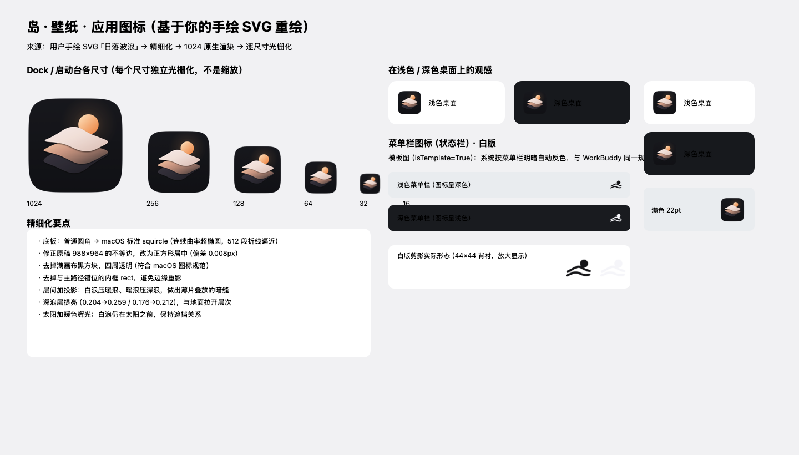

# 岛·壁纸（macOS）

<p align="center">
  
</p>

菜单栏常驻的自动换壁纸应用：定时从 Unsplash / Bing / Wallhaven / 本地目录取图，按题材与内容过滤后设为桌面壁纸。无广告、无弹窗、后台低占用。

**默认开箱即用**：只启用 Bing 岛·壁纸（免 API Key），题材为自然风光 / 城市建筑 / 动物等，人物极少。

| 特性 | 说明 |
| --- | --- |
| 🖥 菜单栏常驻 | 纯白单色剪影图标，22pt 与系统图标等大，随菜单栏明暗自动反色 |
| ⏰ 定时 / 间隔换图 | 支持每日固定时刻（可多个）、按分钟间隔、开机即换 |
| 🗺 多显示器 | 每块屏可各换一张，也可全部同步同一张 |
| 🧹 内容过滤 | 分辨率门槛 + 构图方向 + 中英文屏蔽词 + 题材池，取图口味可控 |
| 🔌 五个图源 | Bing（免 Key）/ Unsplash / Wallhaven / Picsum / 本地目录 |
| 🖼 收藏与屏蔽 | 一键收藏、复制到本地、「不感兴趣」拉黑（可选连作者一起） |
| 🪶 极低占用 | 纯标准库 + PyObjC，无常驻轮询，无网络请求时完全静默 |
| 🔒 只在本机 | 界面走 `127.0.0.1` 静态服务 + WebKit 窗口，不对外暴露端口 |

---

## 1. 安装与运行

### 方式一：下载安装包（推荐，零依赖）

到 [Releases](https://github.com/SunErdao/DaoPapers/releases) 下载 `DaoPapers-<版本>-macOS.zip`（arm64，自带 Python 运行时与依赖，无需装任何环境），解压后把 `DaoPapers.app` 拖进「应用程序」并打开。

> 应用为 ad-hoc 签名（未公证）：首次打开若提示「无法打开」，请**右键 → 打开**；或执行 `xattr -dr com.apple.quarantine /Applications/DaoPapers.app`。

### 方式二：从源码构建

```bash
cd daily-wallpaper
./scripts/install.sh          # 建虚拟环境 → 装依赖 → 打包装机 → 开机自启 → 立即启动
```

常用管理命令：

| 命令 | 作用 |
| --- | --- |
| `./scripts/install.sh status` | 查看是否在跑 |
| `./scripts/install.sh restart` | 改完 `config.yaml` 后重启使其生效 |
| `./scripts/install.sh stop` | 停止（不取消开机自启） |
| `./scripts/install.sh uninstall` | 停止并移除开机自启（保留缓存与收藏） |

打包 / 装机 / 发布包也可以单独做：

```bash
./scripts/make_app.sh            # 只生成构建产物（build/DaoPapers.staging）
./scripts/make_app.sh install    # 打包并装进「应用程序」（启动台可见）
./scripts/make_app.sh dist       # 产出「可分发」zip（自带运行时，供 Release 附件）
```

手动运行（不驻留、方便调试）：

```bash
./.venv/bin/python main.py --once     # 只换一张就退出
./.venv/bin/python main.py            # 常驻（等价于被 launchd 拉起）
```

开机自启通过 `~/Library/LaunchAgents/com.derdao.daopapers.plist` 实现：`RunAtLoad` 登录时执行 `/usr/bin/open -a /Applications/DaoPapers.app`——与「从启动台点图标」完全同路径，菜单栏图标行为一致。若注册时终端不在 GUI 会话（`Load failed: 5`），请在**你自己打开的「终端」App** 里执行：

```bash
launchctl bootstrap gui/$(id -u) ~/Library/LaunchAgents/com.derdao.daopapers.plist
```

依赖只有 PyObjC（提供 AppKit / WebKit 原生能力），HTTP、YAML 解析、图像合成全部用 Python 标准库实现。

### 关于 Mach-O 启动器（macOS 26 必读）

`.app` 的 `CFBundleExecutable` 是 `scripts/build/daopapers_launcher.c` 编译出的 Mach-O 可执行文件：`dlopen libpython` 后在**同一进程内**运行 `main.py`，全程零 execv。

为什么不能省：macOS 26 (Tahoe) 起 Control Center 托管所有第三方菜单栏状态项，并按「启动者的 responsible process」归因。若 `CFBundleExecutable` 是 execv 跳转的 trampoline（shell 包装脚本、解释器再 exec 真身），从启动台 / Finder 启动时**状态项不落户**——进程照跑、API 调用成功，但图标窗口停在 34x0 永不渲染（最小复现：github.com/mkrnr/macos-menu-bar-icon-bug-test-project）。Mach-O 直执启动器让 launchd 生成的进程就是应用本身，状态项据此正常落户。

诊断日志：`data/logs/launcher.log`（启动器各阶段：模式 / dlopen / dlsym / 进入 Python）。

启动器支持两种运行模式（运行时自动选择，`make_app.sh dist` 的产物为前者）：

| 模式 | 触发条件 | 依赖来源 |
| --- | --- | --- |
| **嵌入模式** | bundle 内存在 `Contents/Resources/app/main.py` | 全部来自 bundle：`Resources/runtime`（libpython + stdlib）、`Resources/site-packages`（pyobjc）、`Resources/app`（源码）——换机器零依赖 |
| 开发模式 | 探测不到嵌入 payload | 编译期写死的本机路径（`make_app.sh` 普通构建，仅供开发机） |

---

## 2. 界面与操作

- **菜单栏图标**（太阳与浪线，与应用图标同图形）：下一张 / 上一张 / 换一张新图 / 收藏 / 保存到本地 / 不感兴趣屏蔽此图 / 设置 / 打开配置文件 / 重新载入配置 / 退出。
- **主窗口**：显示今日壁纸大图、标题、作者与来源、分辨率、标签、显示器列表与运行状态。
  - `上一张 / 下一张`：在历史里前后翻（键盘 ← → 同样可用）。
  - `换一张新图`：重新联网取图（空格键）。
  - `收藏`：图片复制到 `Favorites/` 并登记；在「收藏」页可一键设为壁纸。
  - `保存`：弹出系统保存面板，存到任意位置。
  - `不感兴趣`：加入屏蔽表并立即换一张；可选同时屏蔽该作者。

---

## 3. 配置文件（config.yaml）

所有可调项集中在这一个文件，带中文注释。改完保存后：托盘 →「重新载入配置」，或 `./scripts/install.sh restart`。

| 区块 | 关键项 | 说明 |
| --- | --- | --- |
| `app` | `change_on_launch` | 开机 / 启动时立即换一张 |
| | `schedule_times` | 每天固定时间，可多个，如 `["09:00","20:00"]` |
| | `interval_minutes` | 按间隔更换；>0 时优先于固定时间 |
| | `retry` | 网络异常时的静默重试次数与退避 |
| `display` | `fill_mode` | `fill` 裁剪填满 / `fit` 完整显示 / `stretch` 拉伸 / `center` 居中 |
| | `background_color` | `fit`、`center` 模式的留白底色 |
| | `multi_screen` | `independent` 每屏各一张 / `same` 所有屏同一张 |
| `content` | `min_width` / `min_height` / `orientation` | 分辨率与构图门槛 |
| | `blocked_keywords` / `blocked_keywords_zh` | 自定义屏蔽词 |
| | `topics` | 题材池（山川湖海 / 城市 / 极简 / 抽象 / 动物 / 植物 / 纹理…），每次随机组合若干词检索 |
| `sources` | 见下节 | 各图源开关与 API Key |
| `storage` | `cache_dir` / `favorites_dir` / `save_dir` | 缓存、收藏、手动保存目录 |

### 图源

| 图源 | 需要 Key | 特点 |
| --- | --- | --- |
| `bing` | 否 | 默认启用。每日精选，题材以风景 / 城市 / 动物为主，人物极少；自动尝试 4K 原图 |
| `unsplash` | 是（免费） | 题材最可控，支持关键词 / 官方话题 / 收藏集三种检索，需在 `https://unsplash.com/oauth/applications` 申请 Access Key |
| `wallhaven` | 可选 | 图库极大，`categories: "100"` 表示只取 general（精确到不含 people 分类） |
| `picsum` | 否 | 兜底源，仅在其它图源都失败时使用 |
| `local` | 否 | 把自己的图片目录当图源，支持子目录 |

启用 Unsplash：把申请到的 Access Key 填进 `sources.unsplash.api_key`，并把 `enabled` 改成 `true`。

---

## 4. 人物肖像过滤

三道防线，逐层收紧：

1. **图源侧**：Unsplash 用题材池关键词检索 + `content_filter: low`；Wallhaven 用 `categories` 关闭 people 分类。
2. **关键词硬屏蔽**：内置人物 / 肖像 / 写真 / 泳装 / 比基尼 / 婚纱 / 自拍 / 人群等中英文词表（按词边界匹配标题、描述、标签），命中即丢弃。可在 `config.yaml` 里增补。
3. **用户屏蔽表**：点「不感兴趣」后，该图的 id 与直链指纹进入 `data/blocked.json`，后续永不再出现；也可连带屏蔽作者。

> 说明：关键词过滤无法做到 100% 精确（一张风景照仍可能被打上含人的标签，或极少数漏网）。发现漏网图时点「不感兴趣」即可，屏蔽表是确定性的。

---

## 5. 稳定性设计

- **缓存兜底**：下载过的图存在 `cache/`，网络不可用或图源全挂时自动改用缓存，只在状态栏显示一行提示，不弹窗。
- **静默重试**：下载失败按指数退避重试（默认 3 次），期间不打扰。
- **断网不掉链**：启动优先显示缓存图，后台再去拉新图。
- **崩溃自愈**：应用内所有后台线程都有异常兜底；单实例锁用 flock（进程消失即自动释放，不会留下僵尸锁）。开机自启为 `RunAtLoad` 登录触发一次——配合 flock，重复触发只会唤起已有实例，不会双开。
- **资源占用**：常驻仅一个 Python 进程 + 菜单栏图标；界面窗口关闭后不销毁进程，本地静态服务只监听 `127.0.0.1`。

---

## 6. 目录结构

```
daily-wallpaper/
├── main.py                 入口（--once 只换一张 / 默认常驻）
├── config.yaml             集中配置（图源、API Key、时间、填充模式、屏蔽词）
├── requirements.txt        依赖（仅 PyObjC）
├── app/
│   ├── config.py           配置读取 / 路径解析 / 就地回写
│   ├── miniyaml.py         轻量 YAML 读写（保留注释）
│   ├── http.py             标准库 HTTP（超时、重试、原子落盘）
│   ├── downloader.py       下载与缓存
│   ├── imaging.py          按屏幕尺寸合成图片（四种填充模式）+ 纯 Python 图片尺寸解析
│   ├── wallpaper.py        多显示器逐屏设置壁纸（AppKit 调用派发主线程）
│   ├── mainthread.py       AppKit 主线程调度（同步 / 异步派发）
│   ├── filter.py           内容过滤（屏蔽词 / 分辨率 / 构图）
│   ├── store.py            牌堆、收藏、屏蔽表、状态（JSON）
│   ├── engine.py           主链路编排
│   ├── scheduler.py        定时 / 间隔 / 开机触发
│   ├── server.py           仅本机 127.0.0.1 的静态服务
│   ├── runner.py           应用装配与 AppKit 主循环
│   ├── sources/            图源适配器（bing / unsplash / wallhaven / picsum / local）
│   └── ui/                 菜单栏托盘、WKWebView 窗口、JS 桥接 API
├── ui/                     界面（index.html / styles.css / app.js）
├── assets/                 运行时资源（应用图标 + 菜单栏图标），代码里的路径契约
├── cache/                  已下载壁纸缓存 + 按屏幕合成的成品
├── Favorites/              收藏的图片
├── data/                   索引、收藏表、屏蔽表、单实例锁、日志
├── docs/
│   ├── evidence/           验收证据截图（启动台前后对比、运行时上报图标）
│   └── preview/            设计预览图（非运行时依赖）
├── build/                  构建产物与诊断输出（可随时清空重建）
└── scripts/
    ├── install.sh          安装 / 启停 / 卸载（正式入口）
    ├── make_app.sh         打包 .app 并装机（编译 Mach-O 启动器）
    ├── build/              构建链（make_app.sh 直接调用）
    │   ├── gen_icon_svg.py        生成精细化 SVG
    │   ├── build_icons_from_svg.py  多尺寸渲染 → iconset → 自组装 icns
    │   ├── build_icns.py           icns 自组装与校验（只产 PNG 型图层）
    │   ├── gen_tray_white.py       菜单栏白版剪影
    │   ├── gen_tray_icons.py       菜单栏 glyph/solid 多色剪影
    │   ├── embed_brand_icon.py     从 icns 抽 128px 图层内嵌进 ui/index.html
    │   ├── render_svg.py           SVG → PNG 光栅化器（WebKit 快照）
    │   ├── strip_png_chunks.py     剥掉 PNG 的 eXIf 等非白名单 chunk
    │   └── daopapers_launcher.c    Mach-O 启动器源码（进程内嵌 Python，见第 1 节）
    └── tools/              诊断 / 校验 / 预览工具（不参与构建）
        ├── verify_icon_render.py    IconServices 真实渲染验收（唯一权威判据）
        ├── verify_launchpad_icon.py 启动台图标自动验收
        ├── verify_dock_icon.py      Dock 图标验收
        ├── verify_app_icon_e2e.py   三位置端到端验收
        ├── check_syntax.py          AST 语法检查（不写 pycache）
        └── …                        其余单点诊断脚本
```

> **为什么 `ui/` `assets/` `data/` `cache/` `Favorites/` 这几个目录名不能改**：
> 它们是代码里的**路径契约**（`app/server.py` 把项目根当静态服务根、`app/config.py`
> 里的 `data_dir` / `cache_dir` / `favorites_dir`、`app/ui/tray.py` 里的
> `assets/tray`）。改名或移动会直接让运行时找不到文件。其余目录均可自由调整。

---

## 7. 应用图标与菜单栏图标

设计语言对齐个人 IP「DerDao」：**纯平色块、粗几何、双色、零插画、零强渐变**。

**应用图标**（当前版本，2026-10-25 按用户手绘原稿精细化）：macOS 标准 squircle 底板（深蓝黑 `#1b1c22` 附近）+ 一轮暖橙落日（`#ffe9cd` → `#f0924f` 渐变，带暖色辉光）+ 三层柔和起伏的波浪（白浪 `#f8efec`、暖浪、深浪），层间加投影做出「薄片叠放」的立体感。视觉主色只有**深蓝黑底 + 暖橙太阳**两个，白浪不计配色。寓意为「日落海面」，与「岛·壁纸」呼应。

**菜单栏图标**：**纯白剪影**（22pt，模板图，浅色菜单栏自动反色）——与应用图标同一套图形语言：太阳圆盘 + 三层浪线。不另做一套吉祥物：菜单栏是品牌识别的延伸，用户看到的就是 App 图标里那个日落；底板则按菜单栏惯例省略（系统图标、WorkBuddy 状态栏图标均无底板）。

> 历史备注：早期用过「八芒太阳」独立图形，与 App 图标不像；后改为「亮蓝底 + 暖黄太阳」，再按用户手绘「日落波浪」原稿重做；2026-10-25 统一为「深蓝黑底 + 暖橙落日 + 三层浪」，菜单栏改纯白剪影并从 18pt 放大到 22pt 与系统图标等大。

```
assets/AppIcon.icns        macOS 应用图标（16~1024 全尺寸，仅 PNG 型图层）
assets/app-icon.svg        图标源文件（矢量，改这里再重绘）
assets/AppIcon-1024.png    1024 主图
assets/AppIcon.iconset/    10 个尺寸的渲染中间产物
assets/tray/white*.png     菜单栏白版剪影（默认）
assets/tray/appicon*.png   菜单栏满色版
assets/tray/glyph_*.png    菜单栏·无底板剪影版（多色）
assets/tray/solid_*.png    菜单栏·带底板版（多色）

docs/evidence/             验收证据截图（启动台前后对比、运行时上报图标）
docs/preview/              设计预览图（非运行时依赖）
```

重新绘制或微调：**改图形一律改 `assets/app-icon.svg`**（菜单栏白版是自动从它派生的，不要单独改剪影），然后执行

```bash
bash scripts/make_app.sh install   # 重绘图标 → 重打包 → 装进「应用程序」
```

> **为什么不用 `iconutil` 打包 icns**：`iconutil` 一定会额外产出 legacy ARGB / 调色板索引图层（ic04/ic05）。实测本图标的 ic05 调色板色数高达 1282，远超 8 位索引上限 256；系统在启动台、窗口标题栏代理图标等小尺寸场景可能优先取 legacy 层 → **直接显示彩色噪点**（2026-10-25 用户实测截图确认）。因此 `scripts/build/build_icns.py` 自组装 icns，**只产现代 PNG 型图层**，legacy 层成为硬禁令。

**关于"毛边 / 发虚"**：所有图标都是用位图上下文按**矢量参数原生渲染**的，不经过任何缩放；早期版本在 Retina 进程里用 `lockFocus` 会渲染成 2 倍像素再被系统缩回去，那才是发虚的来源。`gen_tray_icons.py` 改用 `NSBitmapImageRep` 作画布后，像素尺寸与文件名严格一致（`@1x=22px`、`@2x=44px`，可用读 PNG 头校验）。

**改完图标后必须重装**：IconServices 会按 **bundle 路径** 缓存图标渲染结果——换 bundle id、换 icns 文件名、覆盖写新文件、`lsregister`、`killall Dock` 全部无效。唯一有效的办法是**把旧 bundle 移走再装回同一路径**（`make_app.sh install` 已自动处理：旧 bundle 移进 `~/.Trash`）。

**菜单栏图标**在 `config.yaml` 的 `display` 段控制，也可以直接在菜单栏菜单 →「菜单栏图标」里点选（会写回配置）：

```yaml
display:
  tray_icon_style: solid   # solid=带底板（默认，App 图标单色版）/ glyph=无底板剪影
  tray_icon_color: auto    # auto=跟随系统明暗 / white / black / gray
  tray_icon_size: 22       # 边长(pt)，与系统菜单栏图标等大（菜单栏厚 22pt）
```

- `auto` 走模板图（template image），浅色菜单栏自动变黑、深色自动变白，最稳。
- `white` 只适合深色菜单栏；`black` 只适合浅色菜单栏；`gray` 两者都还能看，但对比最弱。
- **嫌图标偏小就调 `tray_icon_size`**：上限 22（再大就超出菜单栏厚度会被裁），无需重新生成图片（源图 @2x 是 44px，Retina 下仍清晰）。

## 8. 常见问题

- **启动台 / Dock 点击没反应（点一下像没启动）**：旧版是「辅助型（Accessory）」应用——既**没有 Dock 图标**，又因为代码里没给 `NSApplication` 设 delegate，系统发来的 reopen 事件无人处理，于是对**已运行**的实例「点了没反应」（第二个进程不会启动，`.activate` 文件链路也用不上）。现版已改为**常规应用**（`Info.plist` 的 `LSUIElement=false` + `NSApplicationActivationPolicyRegular`，常驻 Dock + 菜单栏），并在 `app/runner.py` 的 `MenuActions` 上实现 `applicationShouldHandleReopen:hasVisibleWindows:`——启动台 / Dock 点击已运行实例时，直接把主窗口唤到前台（已开则置顶 / 取消最小化）。验证：`pgrep -fl DaoPapers.app` 始终只有一个进程，`data/logs/app.log` 出现「收到系统唤起（reopen），显示主窗口」；`open -a /Applications/DaoPapers.app` 等价于启动台 / Dock 点击，可复现验证。
- **看不到菜单栏图标**：先确认进程在跑（`./scripts/install.sh status`）。
  如果进程在跑、菜单栏却空的，看 `data/logs/app.log` 里有没有「状态栏自检」一行：
  - 自检显示 `38x30`（或类似非零尺寸）= 图标已落户，只是被系统藏了：去「系统设置 → 菜单栏」找到「岛·壁纸」，确认「允许在菜单栏显示」开关打开，且图标没被拖出菜单栏。
  - 自检显示 `34x0` = 状态项未落户。先确认你是**从启动台 / Finder 双击图标**启动的（终端里 `python main.py`、或被 IDE 拉起的 shell 都属于「无图形会话启动者」，状态项不落户）；再看 `data/logs/launcher.log` 确认 Mach-O 启动器各阶段正常。两条都排除后仍 34x0，试试重启 Mac（Control Center 偶发不刷新）。
- **启动台出现两个「岛·壁纸」**：LaunchServices 为每个 `.app` 路径登记一条（含废纸篓里的旧副本——记录是惰性的，文件删了登记还在）。本项目构建中间产物放 `.build/`（点开头，Spotlight 不索引）且 install 后自动清理，正常不会出现。已脏的话：删掉多余 `.app` 和废纸篓副本后逐条注销，保留 `/Applications` 一条：
  ```bash
  LSREG=/System/Library/Frameworks/CoreServices.framework/Frameworks/LaunchServices.framework/Support/lsregister
  $LSREG -dump 2>/dev/null | grep "path:.*DaoPapers" | sort -u   # 看有哪几条
  $LSREG -u "<非 /Applications 的路径>"                          # 逐条注销
  $LSREG -f /Applications/DaoPapers.app && killall Dock
  ```
- **kill 不掉常驻实例 / 重启后旧实例阴魂不散**：启动器在 C 层接管了 SIGTERM/SIGINT（直接 `_exit(0)`），`kill <pid>` 必然秒退。**不要**在 Python 层注册信号 handler——AppKit 主循环停在 C 层，Python handler 没有执行机会，反而屏蔽了内核的默认终止行为，会把进程变成杀不掉的「锁霸」：flock 不释放，后续所有启动都被误判「已在运行」而安静退出（2026-10-25 实测踩坑，查证方法：`pgrep -fl daily-wallpaper` + `ls -la data/.instance.lock`）。
- **一直没换图**：确认 `app.schedule_times` 或 `app.interval_minutes` 至少设置了一个；托盘菜单底部会显示下次更新时间。
- **想换图源**：编辑 `config.yaml` 的 `sources` 区块，然后托盘 →「重新载入配置」。
- **壁纸被系统还原 / 不生效**：首次运行时 macOS 可能要求「系统设置 → 隐私与安全性 → 自动化」权限，允许即可。
- **缓存太大**：调小 `storage.max_cached_files`，或删除 `cache/` 目录（下次会自动重建）。
- **重置屏蔽列表**：设置页底部「清空屏蔽列表」，或删除 `data/blocked.json`。
- **`launchctl bootstrap` 报 `Input/output error`**：说明当前终端不在 GUI 会话中（常见于被 IDE / 自动化工具拉起的 shell），launchd 无法注册。请在**你自己打开的「终端」App** 里执行：
  ```bash
  launchctl bootstrap gui/$(id -u) ~/Library/LaunchAgents/com.derdao.daopapers.plist
  ```
  不需要 sudo。只想先试试效果、暂不开机自启，直接从启动台打开「岛·壁纸」。
- **开机自启只能用 `open -a`，禁止直拉 python**：早期 LaunchAgent（`com.user.dailywallpaper`）用 `KeepAlive` + 直拉 `.venv/bin/python main.py`，两个后果：① launchd 直接生成 python 进程，不是 bundle 的 responsible process，正是 macOS 26 菜单栏图标不落户的路径；② KeepAlive 会把你 kill 掉的实例瞬间拉起，表现为「杀了又活、锁被占、open 无反应」。该文件已于 2026-10-25 卸载删除（`launchctl bootout gui/501/com.user.dailywallpaper` + 删 plist）。当前唯一自启项是 `com.derdao.daopapers.plist`（`open -a` + RunAtLoad，无 KeepAlive）。若怀疑有残留旧 agent：`launchctl list | grep -i wallpaper` + `ls ~/Library/LaunchAgents/ | grep -i wallpaper`。
- **在受限沙箱里跑（如自动化工具内）**：`setDesktopImageURL` 不会真正写入 Dock，日志会显示"已应用"但桌面不变。正常终端里启动才生效。

日志：`data/logs/app.log`（应用日志）、`data/logs/launcher.log`（Mach-O 启动器诊断）、`data/launchd.*.log`（开机自启的 stdout/stderr）。

---

## 9. 许可与致谢

- 代码：[MIT License](LICENSE) · © 2026 孙二岛（DerDao）
- 壁纸图片来自 Bing / Unsplash / Wallhaven / Picsum 等公开图源，各自版权归原作者；本项目只做取图与呈现，不分发图片内容。
- 应用图标与菜单栏图标为原创设计（深色底板 + 暖橙落日 + 三层波浪），随 MIT 协议一并授权。
